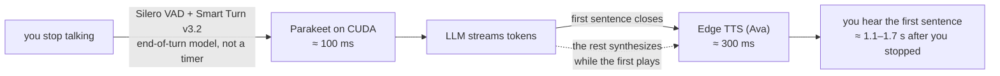
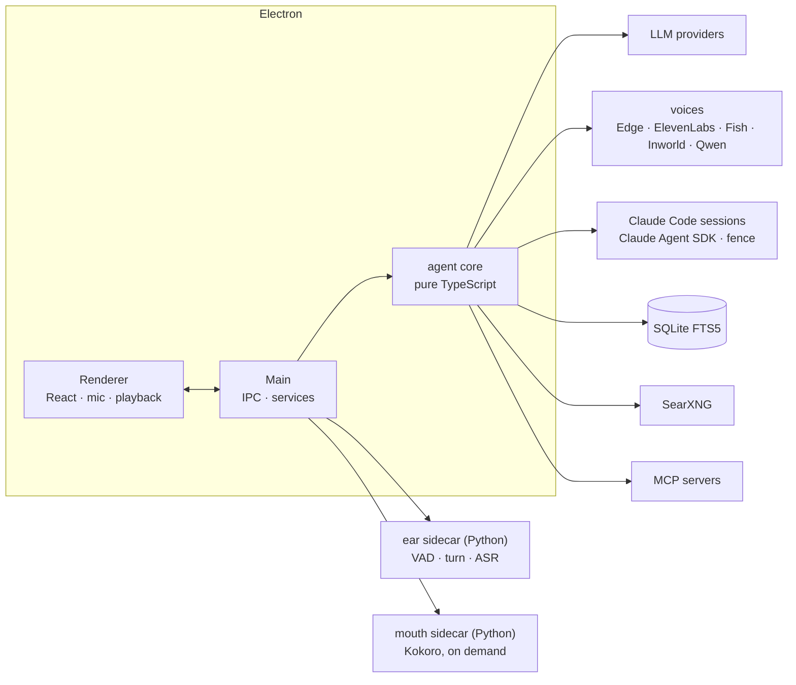

<div align="center">

# Voice Agent

**A voice harness for Claude Code: talk to one agent, and it runs all your sessions in parallel, asks before it acts, and tells you when they're done.**

[](https://github.com/nodeblackbox/voice-agent/actions/workflows/ci.yml)


*[Watch the full two-minute video](VIDEO_URL_HERE)*

</div>

Running four Claude Code sessions sounds fast. Until you're the one switching tabs. Which one finished?
Which one has been waiting on you for ten minutes? That's the context-switching tax.

Voice Agent fixes that. It's a desktop harness for Claude Code, built on the Claude Agent SDK. You talk to
one agent, and it starts, steers and checks on every coding session for you. It only speaks up when a
session needs you, and it tells you when they're done. You stop babysitting terminals, hand off the
work, and come back to review the results.

It is also a complete voice assistant in its own right: Parakeet ears on your GPU, an end-of-turn model
instead of a silence timer, a reply that starts in about a second and stops the moment you cut in, local
web search, a memory with a real UI, and any LLM brain you have a key for.

## What it does

| | |
|---|---|
| **Spin up sessions by voice** | "Start four sessions: a pricing page, a users API, fix the login test, and update the README." Each one is a real Claude Code session in its own folder, and they all work at the same time. |
| **Watch it work** | Open any session and see its timeline live: shell commands as a terminal, edits as diffs, new files as code, to-do lists as checklists, plans as Markdown. |
| **Steer while it works** | Queue follow-ups ("oh, and add rate limiting to the API"), or stop it and redirect. |
| **Ask how it's going** | "How's the login fix going?" gets a short spoken update. No scrolling through logs. |
| **It asks, you decide** | When a session needs a decision it asks you out loud, with numbered options. "The third one." A command that needs approval is a spoken yes or no. |
| **Choose how much it asks** | Per session: **Plan** (plans first, waits for your sign-off), **Ask** (every command checks with you), **Auto** (just works, fenced to its folder), **Bypass** (no prompts). Approve a plan by voice. |
| **Review the result** | Every file it changed, marked added or modified; a code, Markdown, image, video, audio and PDF viewer; a live preview of web pages it builds at desktop, tablet and phone widths. |
| **Continue any session** | It lists the Claude Code sessions saved on your machine from the terminal and the IDE, and continues any of them on a copy. The original stays untouched. |
| **Fenced and safe** | Each session is fenced to its own folder. Anything outside it, any delete or push, asks you first. Machine-level commands are refused in every mode. Sessions run on your existing Claude login, never on an API key. |

<div align="center">

</div>

### Ask it afterwards

The point of handing work off is being able to find out what happened without reading everything.

- **"What did it just do?"** gives a spoken digest of the last turn: which tools ran, what got blocked, how it ended. "Read me the plan" or "what were the last steps?" goes deeper on demand. **"What files did it make?"** lists the newest ones.
- Session timelines are saved, so the answers survive a restart.
- **"What were my other Claude sessions about?"** covers the ones you ran in a terminal.
- The agent's own past is searchable too: it remembers facts you tell it (with a full history and undo), and lines from earlier conversations are retrieved when they are relevant.
- Every voice turn is written to a structured trace. The **Diagnostics** view shows the last turn as a timeline with latency numbers, and **Copy diagnostics** produces a self-contained report.

<div align="center">

</div>

### Why the voice context stays light

Each Claude Code session does its heavy work in its own context. The voice model only sees a one-line
brief per session; details are fetched when you ask. Idle sessions shrink to a name and a status, tool
results in the conversation are compacted, history is capped, and the stable half of the system prompt is
cached. So you can run several sessions for an hour and the agent still answers in about a second.

## The voice loop



- **End-of-turn detection.** You can pause mid-thought without being cut off; a turn model decides, and an unfinished sentence gets a short window to continue.
- **Barge-in that cancels everything.** Talk over it: playback cuts about 100 ms after you start speaking, aborting the model, any running tool, the TTS sockets and the audio queue. The next turn knows exactly which sentences you heard.
- **Resume from the cut.** "Go on" replays from the sentence that was interrupted, with no model call.
- **One steady voice.** Edge TTS is free and keyless. When it is rate-limited, a local Kokoro-82M voice takes over and the app probes Edge in the background until it is back.
- **Or a hosted one.** ElevenLabs, Fish Audio, Inworld and Qwen (Alibaba Model Studio) plug into the same sentence pipeline: add a key, pick the voice and model from the live listing, and the model may write delivery cues (`[laughs]`, `(sighing)`) for engines that understand them. A proxy toggle gets Edge past a throttled IP; `pnpm tts:latency` compares every route.
- **A model chain that survives bad days.** The configured model, then your backup, then a last resort; models that are rate-limited or too small for the request are skipped; Groq keys rotate; auth failures fall straight through. A spoken filler and a soft cue cover tool calls.

## Also in the box

**Memory** (SQLite + FTS5, global and per-project, history with undo, optional confirm-before-save) ·
**Projects** (a folder, a notebook, a default prompt style) · **Prompt styles** (complete system prompts;
draft or refine one with AI) · **Skills** (trigger + procedure snippets) · **MCP servers** (stdio and
streamable HTTP, added from Settings) · **Web search** (local SearXNG, started on demand) · **Tuning**
(every timing parameter documented, with an advisor that reads your session and suggests values) ·
**Light and dark themes**.

<div align="center">

</div>

## Getting started

**Requirements:** Windows 11, Node 22.13+, [pnpm](https://pnpm.io) 10, Python 3.11 and [uv](https://docs.astral.sh/uv/)
(for the ears), an NVIDIA GPU with a CUDA 12 driver (CPU mode exists but is slower), and an API key for at
least one LLM provider. Claude Code sessions additionally need a Claude login.

```powershell
git clone https://github.com/nodeblackbox/voice-agent.git
cd voice-agent
pnpm install
copy .env.example .env         # paste at least one provider key (or add keys in Settings later)
pnpm sidecar:install           # Python venv for the ears + Smart Turn model (~9 MB now; Parakeet ~600 MB on first use)
pnpm searxng:install           # optional: local web search, from source
pnpm dev
```

Then, in the app:

1. **Settings → Providers**: paste the keys you have. Only models whose provider has a key are offered; with none at all the chat tells you where to add one.
2. **Settings → Voice input**: pick a microphone, or leave the system default.
3. **Claude Code view → Settings**: switch sessions on. The badge in the sidebar shows which login they will run on. If it cannot find one, install the CLI and log in once: `npm i -g @anthropic-ai/claude-code`, then `claude` and `/login`.

Press **Voice** (or `Ctrl+Shift+Space` while the window is focused) and talk. `Enter` sends typed text,
`Esc` stops the agent.

### What works with what

| You have | You get |
|---|---|
| Nothing but Node | The app opens, Edge TTS speaks, typed chat tells you it needs a key. |
| One LLM key (any of Anthropic, OpenAI, Groq, Google, xAI) | Typed chat, memory, projects, styles, skills, MCP, the tuning advisor. |
| A voice key (ElevenLabs, Fish Audio, Inworld or Qwen) | That voice instead of Edge, with its voices and models listed in Settings. |
| + Python and the sidecar | Voice: ears, barge-in, resume, the Kokoro fallback voice. CPU works; a CUDA GPU makes it fast. |
| + SearXNG | `web_search`, `read_page` and `research` tools. |
| + a Claude login | Voice-managed Claude Code sessions. They bill your subscription, not your key. |

The step-by-step version, with every model and where it lands on disk, is in **[docs/SETUP.md](docs/SETUP.md)**.

## Architecture



- **[docs/ARCHITECTURE.md](docs/ARCHITECTURE.md)**: processes, the life of a turn, interruption, prompt composition, the error policy.
- **[docs/CLAUDE_SESSIONS.md](docs/CLAUDE_SESSIONS.md)**: everything about voice-managed sessions, modes and the fence.
- **[docs/EXTENDING.md](docs/EXTENDING.md)**: how to add a provider, a tool, an MCP server, a voice, a style or a tuning parameter. Written for people and for coding agents; **[AGENTS.md](AGENTS.md)** is the one-page map.
- **[docs/TUNING.md](docs/TUNING.md)** and **[docs/DEBUGGING.md](docs/DEBUGGING.md)**: every parameter, every trace event.
- [sidecar/PROTOCOL.md](sidecar/PROTOCOL.md) is the ears' wire protocol; [NEW_ARCHITECTURE.md](NEW_ARCHITECTURE.md) is the original planning document, kept as history.

```
src/main        Electron main: window, IPC registry, services (sidecar, Kokoro, SearXNG, MCP, Claude sessions, settings)
src/core        agent core with no Electron imports: providers, prompts, turn runner, speech, tools, memory, claude/
src/renderer    React UI (views/claude is the Claude Code view), audio capture and playback, zustand store
src/preload     typed window.api bridge
src/shared      types, IPC channel names and tuning schema shared by every layer
sidecar/ear     Python ears: Silero VAD + Smart Turn + Parakeet behind a local websocket
sidecar/mouth   Python mouth: Kokoro-82M, started when Edge TTS is unreachable
search/         SearXNG installer, settings template, run script
mcp/            mcp.json and the first-party demo server
lab/            runnable experiments against the real Claude Agent SDK, with findings
docs/           guides, architecture, screenshots, the demo GIF
```

## Testing

```powershell
pnpm test                   # vitest: core (mock LLM, scripted fake SDK, temp SQLite), main services, renderer (jsdom)
pnpm test:coverage
pnpm typecheck
pnpm test:py                # pytest with fake models; no GPU or torch needed
```

CI runs all of it on pushes to `main` and on pull requests: the TypeScript suite on Windows, the Python
suite on Linux without `torch` or `onnxruntime` installed, to prove the sidecar's logic is separable from
its models.

### Development hooks

Set before `pnpm dev`: `VA_USER_DATA=<dir>` runs against a separate data folder (fresh-user testing;
your real settings and memory stay untouched); `VA_SAY="..."` sends a typed message after launch;
`VA_WAV=file.wav` replays a 16 kHz mono wav through the ears (`VA_WAV2` injects a second one while the
agent speaks, to test barge-in); `VA_MIC=1` presses the Voice button; `VA_VIEW="Claude Code"` opens a rail
view; `VA_SCREENSHOT=out.png` captures the window after `VA_SCREENSHOT_DELAY` ms; `VA_TRACE=1` prints the
session trace path on quit.

Logs live in `%APPDATA%/Voice Agent/logs/`: `app.log` (rotated, flood-guarded), `errors.log`, and
`sessions/<id>.jsonl`, a structured trace of every turn. Settings, keys (encrypted with Electron
`safeStorage`), the memory database and the Claude session list live next to them; delete the folder to
start fresh.

**Training recording mode** (opt-in, for building a voice-clone dataset): `RECORD_TRAINING_DATA=1` in
`.env` saves every user turn as raw 48 kHz WAV plus JSON context, and talks through a recording-coach
prompt. See [docs/TRAINING_RECORDING.md](docs/TRAINING_RECORDING.md).

## Roadmap

- Packaged installer with the sidecars bundled (today you run from source).
- Playbooks for Claude Code sessions: "when session X finishes, …", auto-answer rules, stacked-prompt templates, image hand-off.
- Expose the agent itself as an MCP server.
- Semantic memory behind the same `recall` interface (today: FTS5 BM25).
- macOS and Linux (the sidecar launcher and the fence's shell parsing are Windows-first).

## License

MIT
