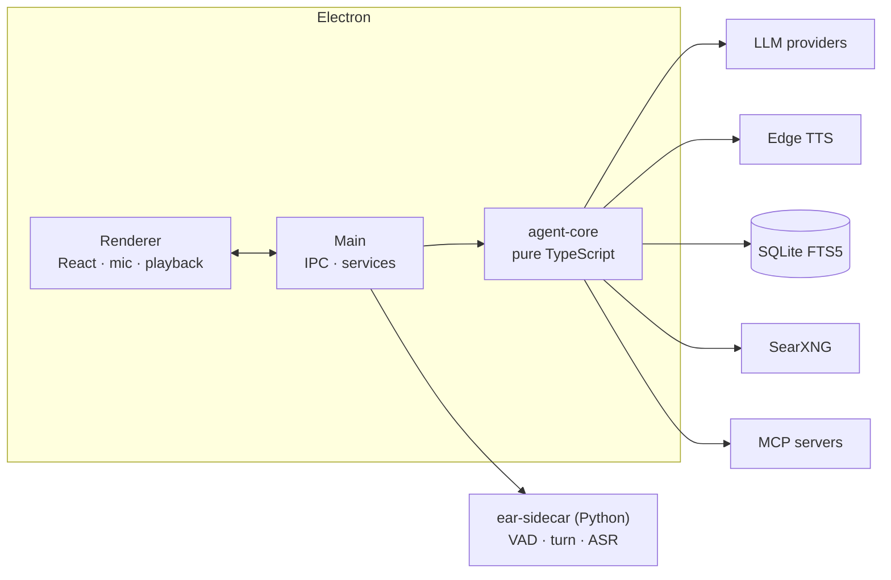

<div align="center">

# Voice Agent

**A desktop voice assistant that listens like a person, answers in under two seconds, and shuts up when you interrupt it.**

[](https://github.com/nodeblackbox/voice-agent/actions/workflows/ci.yml)


</div>

Parakeet ears on the GPU, Edge TTS (Ava) voice, any LLM brain (Anthropic, Groq, Gemini, xAI), local
SearXNG web search, SQLite memory with a real UI, switchable prompt styles and skills, and MCP tool
servers that you can add from the settings screen. Electron + TypeScript, with one small Python
sidecar for audio.

<div align="center">

</div>

## Why it feels fast


- **End-of-turn detection, not a silence timer.** You can pause mid-thought ("um… so…") without
  being cut off; a real turn model decides.
- **Sentence-level streaming.** The first sentence is spoken while the model is still writing.
- **Barge-in that actually cancels.** Talk over it: playback ducks after ~100 ms of your speech and
  cuts after ~300 ms, aborting the model, any running tool, the TTS sockets and the audio queue.
- **Tools without dead air.** A spoken filler and a soft loading cue cover search and memory
  lookups; the transcript shows the query, elapsed time and the sources it used.

## Features

| | |
|---|---|
| **Brain** | One provider layer (Vercel AI SDK) over Anthropic (default: Claude Haiku), Groq (key pool, rotates on 429), Gemini and xAI. Retry → fallback model → spoken notice. |
| **Ears** | Parakeet TDT 0.6B v2 via `onnx-asr` (hybrid CUDA/CPU), Silero VAD, Smart Turn v3.2. Live partial captions. |
| **Voice** | Edge TTS, Ava by default, 300+ voices with preview. System voice as emergency fallback. |
| **Search** | SearXNG installed from source and started on demand; `web_search`, `read_page` (Readability), `research`. |
| **Memory** | SQLite + FTS5. Profile facts are always in context; relevant facts are retrieved per utterance. Global and per-project scopes. Full CRUD UI, optional confirm-before-save. |
| **Prompts** | Styles are complete system prompts with a length and a format axis. Create one from a brief with AI, or *refine* an existing one ("stop saying 'great question'"). |
| **Skills** | Trigger + procedure snippets the model reads before acting. Toggle, edit, or draft with AI. |
| **MCP** | Official SDK client, stdio and streamable HTTP. Add/enable/test servers from Settings; per-server logs; a bundled demo server as a smoke test. |
| **Context** | Time, timezone, location (manual or IP), active project and enabled skills are injected every turn. |
| **UI** | Dark, keyboard-friendly, state indicator (listening / thinking / searching / speaking), sessions, latency and token readouts. |

## Architecture



The full map — processes, the life of a turn, the interruption state machine, prompt composition
and the error policy — is in **[docs/ARCHITECTURE.md](docs/ARCHITECTURE.md)**. The sidecar's wire
protocol is in [sidecar/PROTOCOL.md](sidecar/PROTOCOL.md). The original planning document, written
before any code, is [NEW_ARCHITECTURE.md](NEW_ARCHITECTURE.md).

## Getting started

Requirements: Windows 11, Node 22+, [pnpm](https://pnpm.io) 10, Python 3.11, [uv](https://docs.astral.sh/uv/),
an NVIDIA GPU with a CUDA 12 driver (CPU mode exists but is slow), and API keys for the providers you use.

```powershell
pnpm install
pnpm sidecar:install        # Python venv for the ears + Smart Turn model download
pnpm searxng:install        # SearXNG from source (optional, for web search)
pnpm dev
```

Then in **Settings**:
1. **Providers** — paste API keys (stored with Electron `safeStorage`). A `.env` in the repo root is
   also read in development: `ANTHROPIC_API_KEY`, `GROQ_API_KEY` or `GROQ_KEYS` (JSON list),
   `GEMINI_API_KEY`, `XAI_API_KEY`.
2. **Voice input** — pick your microphone and output device (a Blue Yeti is preselected if present).
3. **Web search** — *Start now* once; afterwards the agent starts SearXNG on demand.

Press **Voice** (or `Ctrl+Shift+Space`) and talk. `Enter` sends typed text, `Esc` stops the agent.

## Project layout

```
src/main        Electron main: window, IPC registry, service managers (sidecar, SearXNG, MCP, settings)
src/core        agent core with no Electron imports: providers, prompts, turn runner, speech, tools, memory
src/renderer    React UI, audio capture/playback, zustand store
src/preload     typed window.api bridge
src/shared      types and IPC channel names shared by every layer
sidecar/        Python ears: Silero VAD + Smart Turn + Parakeet behind a local websocket
search/         SearXNG installer, settings template, run script
mcp/            mcp.json and the first-party demo server
docs/           architecture, diagrams, screenshots
```

## Testing

```powershell
pnpm test                   # vitest: core (mock LLM, temp SQLite), main services, renderer (jsdom)
pnpm test:coverage
pnpm typecheck
cd sidecar; python -m pytest tests -q  # pytest with fake models; no GPU or torch needed
```

CI runs all of it on every push. The Python suite deliberately runs without `torch` or
`onnxruntime` installed to prove the sidecar's logic is separable from its models.

## Development hooks

Set before `pnpm dev`: `VA_SAY="..."` sends a typed message after launch; `VA_WAV=file.wav`
replays a 16 kHz mono wav through the ears (`VA_WAV2` injects a second one while the agent speaks,
to test barge-in); `VA_MIC=1` presses the Voice button for you; `VA_SCREENSHOT=out.png` captures
the window after `VA_SCREENSHOT_DELAY` ms; `VA_TRACE=1` prints the session trace path on quit.

Logs live in `%APPDATA%/Voice Agent/logs/`: `app.log` (rotated, flood-guarded), `errors.log`, and
`sessions/<id>.jsonl` — a structured trace of every turn. The Diagnostics view shows the last turn
as a timeline with the latency numbers, session p50/p95, ear stats and recent errors, and **Copy
diagnostics** produces a self-contained Markdown report. See `docs/DEBUGGING.md` for the event
vocabulary and `docs/TUNING.md` for every tuning parameter (Settings → Tuning; export/import
profiles as JSON).

**Training recording mode** (opt-in, for building a voice-clone dataset): `RECORD_TRAINING_DATA=1`
in `.env` saves every user turn as raw 48 kHz WAV + JSON context, and talks through a recording-coach
prompt. Off by default; it lives in `src/main/training/`. See `docs/TRAINING_RECORDING.md`.

## Roadmap

- Claude Code session control from voice (attach, get read the result, answer "needs input" prompts).
- Resumable sessions with summarised context.
- Expose the agent itself as an MCP server.
- Semantic memory behind the same `recall` interface.
- Packaged installer with the sidecar bundled.

## License

MIT
