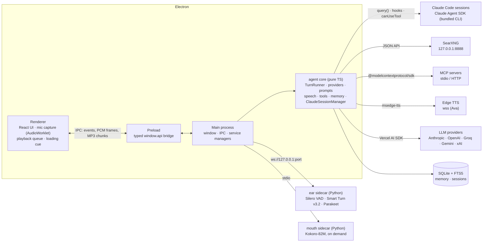
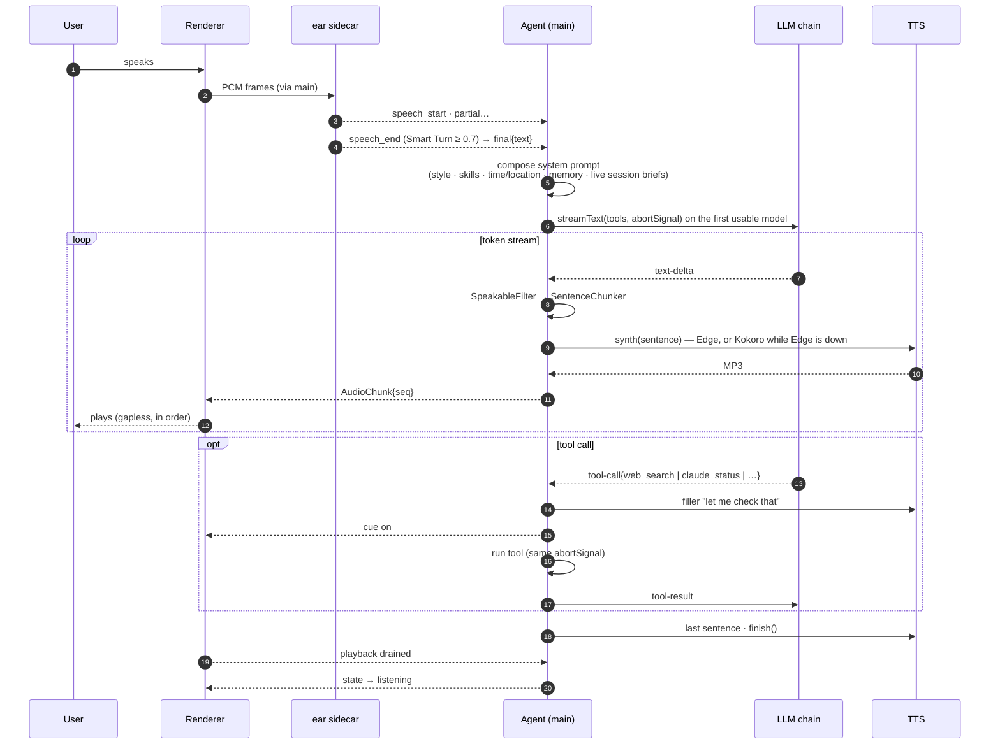
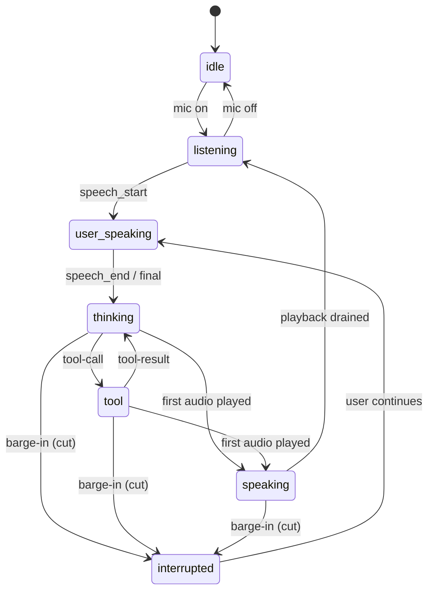
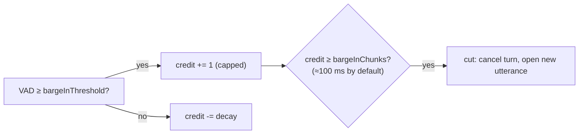
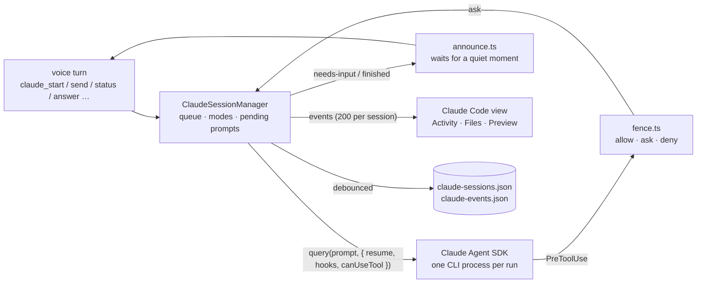
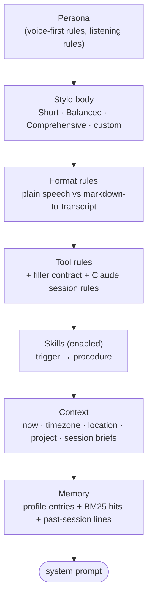
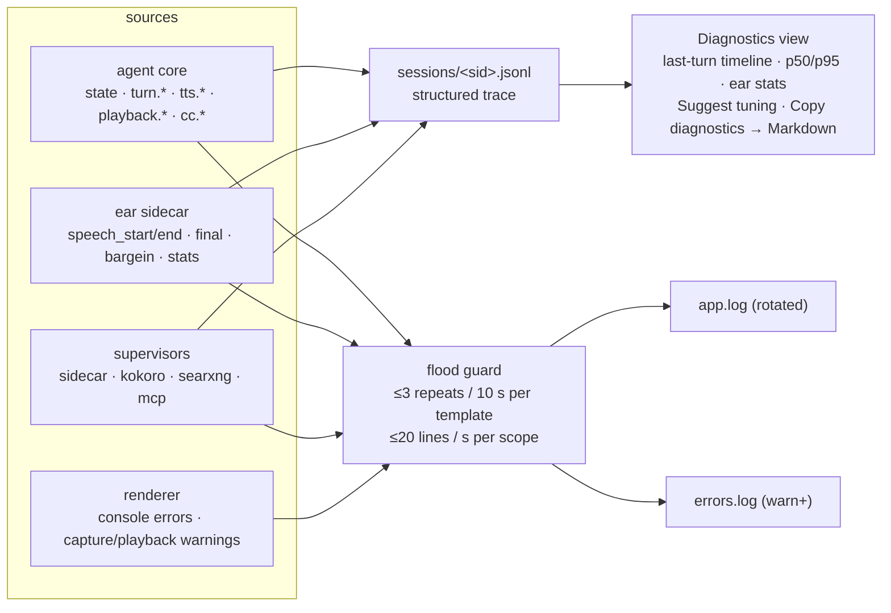
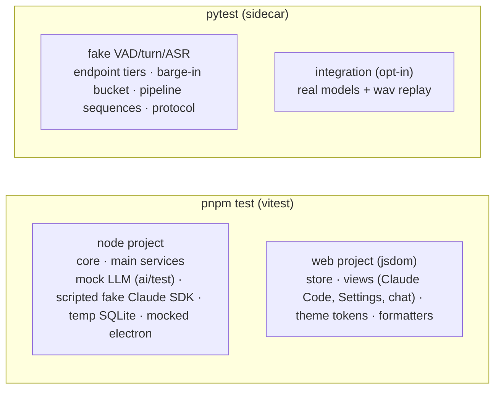

# Architecture

Voice Agent Harness is an Electron desktop app whose brain is TypeScript and whose ears (and fallback mouth) are
small Python sidecars. This page is the map: processes, the life of one voice turn, how an interruption
cancels everything, how Claude Code sessions hang off the same core, and where each concern lives. The
planning history is in [../NEW_ARCHITECTURE.md](../NEW_ARCHITECTURE.md); the ear protocol is in
[../sidecar/PROTOCOL.md](../sidecar/PROTOCOL.md); the sessions feature has its own guide in
[CLAUDE_SESSIONS.md](CLAUDE_SESSIONS.md).

## Processes

Everything outside the Electron box is a child process or a network service owned and supervised by the
main process. The renderer never talks to them directly; it reads a session's workspace through the
read-only `ccws://` protocol that main serves (files, media with byte ranges, and the live preview frame).

| Concern | Where | Notes |
|---|---|---|
| Mic capture, device choice, AEC | `src/renderer/src/audio/capture*.ts` | Chromium's echo cancellation; 16 kHz int16 frames. Self-cut suspects are counted in Diagnostics. |
| Playback, ducking, ordering | `src/renderer/src/audio/playback.ts`, `chunk-queue.ts` | Chunks are MP3 per sentence; a pure `ChunkQueue` guarantees seq order and terminal markers. |
| Speech detection, end-of-turn, ASR, barge-in credit | `sidecar/ear/*` | Magic numbers are config sent at connect time; a watchdog restarts a hung decode. |
| One turn: model chain → sentences → TTS → chunks | `src/core/turn/runner.ts`, `src/core/speech/*` | One `AbortSignal` per turn reaches every I/O. |
| Orchestration, state machine, sessions, announcements | `src/core/agent.ts`, `src/core/turn/state-machine.ts` | No Electron imports; unit-tested with mocks. |
| Providers, keys, capacity, resolution | `src/core/providers/*` | Model ids are `provider:model`; `resolveModel` picks a keyed provider when the chosen one has no key; `ModelCapacity` remembers 413s and 429s; the Groq pool rotates keys. |
| Prompts, styles, skills, speakable text | `src/core/prompts/*` | Style = full prompt body + length/format; skills are injected procedures; the stable half of the prompt is cached. |
| Tools | `src/core/tools/*` | `web_search`/`read_page`/`research`, memory tools, `current_time`, the `claude_*` family, MCP adapter. |
| Claude Code sessions | `src/core/claude/*` | `ClaudeSessionManager` (queue, interrupt, modes, pending prompts), `fence.ts` (allow / ask / deny before any permission logic), `sdk.ts` (real adapter, env scrub), `digest.ts` / `announce.ts` (what gets spoken), `persist.ts` (saved timelines). |
| Memory, chat sessions, projects | `src/core/memory/store.ts` | `node:sqlite` + FTS5 BM25; scopes = global + one per project; per-entry history. |
| Services | `src/main/services/*` | sidecar supervisor, Kokoro mouth, SearXNG, MCP, Claude service (persistence, `ccws://`), settings + encrypted keys, logs and traces. |

## One voice turn

Measured on the reference machine (RTX 4090, Claude Haiku 4.5): end of speech → transcript ≈ 100 ms,
→ first audio ≈ 1.1–1.7 s.

**Before the model is called** the transcript may be held: a sentence that ends on a filler word or scored
low on Smart Turn opens a short continuation window, and if you keep talking the fragments merge into one
turn. **After an interruption**, "go on", a backchannel or a wordless cut replays the reply from the cut
sentence without a model call (`turn/resume.ts`).

**The model chain** (`turn/runner.ts`): the configured model (or, when its provider has no key, a model
from a provider that does), then the chosen backup, then a last resort. Models known to be too small for
the request or rate-limited for more than a short wait are skipped up front; a first-token timeout is not
retried on the same model; transient errors get one retry; auth errors fall through; Groq keys rotate.
Words already spoken are never restarted on another model.

## Interruption

Barge-in has to cancel *everything*, not just the audio. The sidecar decides, the agent cancels.

While the agent speaks the sidecar runs a leaky-bucket credit on speech probability. The default
(`bargeInInstant`) cuts as soon as the credit reaches about 100 ms of speech, with no duck stage; the older
staged behaviour (duck at ~100 ms, cut at ~320 ms, release if it was a backchannel) is still available
through tuning.

On `cut` the agent aborts the turn's `AbortController`. That single signal is threaded into the LLM stream,
every tool call (SearXNG `fetch`, MCP `callTool` → `notifications/cancelled`, a Claude session's
`interrupt()`), the TTS sockets, the filler and loading cue, and the renderer's playback queue. The partly
spoken reply is kept in the transcript marked *interrupted*, with `spokenText` and `unspokenText`, so the
next model call sees what the user really heard, and a resume can start from the right sentence.

## Claude Code sessions

A session is a folder under the workspace root (or a project folder you picked) plus an SDK session id
to resume by. Nothing runs after a restart until the next send. The voice model gets a one-line brief per
session in its system prompt and short spoken digests; `claude_details` reads more only on request. The
fence runs before the SDK's own permission logic and answers allow, ask or deny from the session's mode
and the command's reach; an "ask" becomes a spoken yes/no. Sessions run with `ANTHROPIC_API_KEY` stripped
from their environment so they bill the user's login; a run that reports any other key source is stopped.

## Prompt composition

Every turn rebuilds the system prompt from parts, so switching style or toggling a skill takes effect
immediately. The stable parts come first and are cached by the provider; the live parts change per turn.

For markdown styles, `SpeakableFilter` runs on the token stream before the sentence chunker: fenced code
becomes "the code is in the conversation", lists and links are flattened for the voice, and the transcript
keeps the full markdown.

## Error policy

| Failure | Behaviour |
|---|---|
| Utterance too short / empty transcript | Dropped silently; stays listening. |
| Sidecar crash / CUDA missing | Restart with backoff (1 s, 3 s, 10 s); exit code 3 → "switch STT to CPU" hint. Typed chat keeps working. |
| No transcript within 25 s of speech end | The ears are restarted, the user is told once, the turn is dropped. |
| No key for the chosen model's provider | Another keyed provider answers (one toast says so); with no keys at all the reply says where to add one. |
| No first token in time, stall, 5xx, dropped connection | Next model in the chain (one same-model retry for transient errors); a spoken notice names the switch. Spoken words are never restarted. |
| 413 / 429 from a provider | The model's ceiling or wait is remembered and it is skipped next time; Groq keys rotate. |
| Tool error / SearXNG down | Returned to the model as an error string; pill turns amber; one `ensureRunning()` attempt first. |
| Edge TTS failure or 429 | Retry the sentence once, then Kokoro for the rest of the conversation while a background probe backs off (1/2/4 min, or 5/10/20 for 429s); the Windows voice covers while Kokoro loads; a toast says when Edge is back. |
| Claude session dropped (socket closed) | Marked `error`; the next send resumes it by SDK session id. |
| Barge-in during a tool | Same cancel path; late tool results are discarded by turn id. |

## Observability

Every behavioural number is a documented tuning parameter (`src/shared/tuning.ts`, [TUNING.md](TUNING.md));
every turn is reconstructible from the session trace (`logs/sessions/<sessionId>.jsonl`,
[DEBUGGING.md](DEBUGGING.md)), including the `cc.*` events of the Claude sessions.

Per-frame data (VAD levels) never reaches disk. Transcript text can be redacted from the trace with
`runtime.logTranscripts`.

## Testing

CI runs the TypeScript suite on Windows and the Python unit suite on Linux without torch or a GPU. The lab
scripts in `lab/claude-sdk` exercise the real Claude Agent SDK and keep their findings in
`lab/claude-sdk/FINDINGS.md`; they are run by hand.
